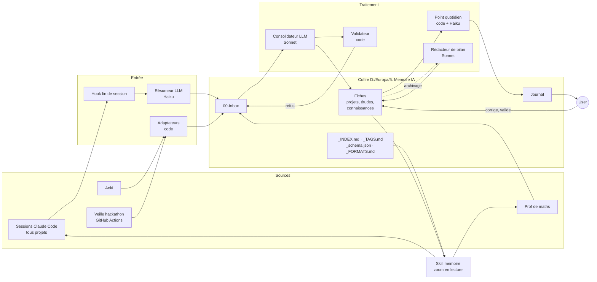

# Architecture

Vue d'ensemble de tous les composants de la mémoire et des harness qui s'y branchent : ce qui est du code, ce qui est un agent, ce qui est une skill, comment ça tourne, et ce qui est fait ou à faire. La conception détaillée est dans `VISION.md`, les décisions dans `docs/DECISIONS.md`. La dernière section vérifie la conformité aux principes de `GUIDE-ARCHITECTURE-AGENTIQUE.md`.

État au 2026-10-28 : étapes 1 et 1 bis faites (structure, schéma en données, validateur, 29 tests) ; étape 2 à faire par le user.

## En une phrase

Un **coffre Markdown versionné par git**, alimenté par une **inbox** que remplissent des **workflows** (sessions Claude Code, harness), rangé par **un seul consolidateur**, vérifié par **du code**, relu par le user chaque jour, et lu par n'importe quelle session grâce à **une skill de zoom**.

Il n'y a **aucun agent autonome** au sens du guide (section 1) : tous les composants à LLM sont des workflows au chemin fixé par le code, et le modèle n'intervient que là où il faut comprendre ou rédiger du texte.

## Schéma

## Les composants

Légende de la nature : **stockage** (des fichiers), **code** (déterministe, sans modèle), **agent** (un appel de modèle encadré par du code), **skill** (une procédure que suit une session Claude Code), **hook** (déclenché par Claude Code), **tâche planifiée** (déclenchée par l'horloge).

### Stockage

| Composant | Rôle | Type de mémoire (guide, 4.5) | État |
|---|---|---|---|
| Coffre `5. Memoire IA` (git local) | Les fiches : projets, composants, connaissances, cours, notions, travaux | Sémantique (faits durables) et épisodique (bilans, suivi daté) | Fait |
| `_INDEX.md` | Niveau 1 du zoom : une ligne par projet et par cours | Noyau toujours lu en premier | Fait (écrit à la main ; généré par code plus tard, décision 12) |
| `_TAGS.md` | Vocabulaire de tags autorisé | — | Fait |
| `_schema.json` + `_FORMATS.md` | Le contrat : types de fiche, champs, règles (lu par le code / décrit pour le user) | — | Fait ; un test vérifie que les deux listent les mêmes types |
| `_gabarits/` | Un modèle de fiche par type | Procédurale | Fait |
| `00-Inbox/` | Notes brutes en attente de consolidation | Épisodique (temporaire) | Fait (vide) |
| `Journal/` | Points quotidiens | Épisodique | Format à définir (étape 6) |
| Données brutes des harness | Base Anki, `state/hackwatch.db`… | Hors coffre, jamais copiées | Existent dans chaque harness |
| Transcripts Claude Code | Historique complet des sessions (`~\.claude\projects`) | Épisodique brute | Conservés 10 ans (`cleanupPeriodDays`) |

### Code (algorithmes, sans modèle)

| Composant | Rôle | Quand il tourne | État |
|---|---|---|---|
| `scripts/valider_fiches.py` | Vérifie chaque fiche contre le schéma : champs, tags, emplacement, dates, règles de l'inbox | À la demande, dans les tests, et **après chaque consolidation** (barrière avant commit) | Fait ; lit `_schema.json`, aucun type en dur |
| Recherche du zoom (à venir, avec la skill) | Filtre les fiches par tags et frontmatter sans lire leur corps ; calcule les échéances | Appelé par la skill `memoire` | Étape 3 |
| Générateur d'`_INDEX.md` | Reconstruit l'index depuis les frontmatters | Après chaque consolidation | Plus tard (après l'étape 2) |
| Extraction du diff git | Liste ce qui a changé dans le coffre sur 24 h | Point quotidien | Étape 6 |
| Adaptateur Anki | Lit la base Anki et écrit une synthèse de révision dans l'inbox | Tâche planifiée | Étape 8 |
| Adaptateur veille hackathon | Lit les hackathons retenus et écrit des notes `provenance: externe` dans l'inbox | Tâche planifiée locale (voir point ouvert 1) | Étape 8 |
| Scripts de migration | Transforment les fiches lors d'un changement incompatible du schéma | À la demande, avec simulation | Si besoin |
| Runner d'évaluations | Rejoue `evals/questions.md` et mesure | Après chaque changement | Étape 3 |

Les adaptateurs sont **du code, pas des agents** : ils transforment un format bien défini en note d'inbox, ce qui ne demande aucun jugement. La table de `VISION.md` prévoyait Haiku pour leur exécution ; c'est seulement à garder en réserve si un adaptateur doit résumer du texte libre.

### Agents (un modèle encadré par du code)

| Agent | Entrée → sortie | Déclencheur | Modèle d'exécution | Garde-fous | État |
|---|---|---|---|---|---|
| Résumeur de session | Transcript d'une session → une note d'inbox (idées, décisions, erreurs, état, fichiers touchés, lien vers la session) | Hook de fin de session | Haiku (à confirmer par les évals) | N'écrit que dans l'inbox ; sessions triviales ignorées (seuil à définir) ; sortie validée par le validateur | Étape 4, attend la réflexion du user sur « que retenir » |
| Consolidateur | Notes d'inbox → une liste d'opérations JSON (`ajouter`, `creer`, `remplacer`, `champ`, `rien`, `hors_schema`), appliquée par du code | Une fois par jour avant le point (décision 20) | Sonnet | Seul écrivain des fiches ; ne réécrit jamais une fiche entière ; une source par fait ; verrou ; validateur avant commit ; pas d'accès réseau ; `a_valider` respecté ; ne touche jamais au schéma | Étape 5 |
| Rédacteur du point quotidien | Diff git + échéances → `Journal/AAAA-MM-JJ.md` | Tâche planifiée quotidienne | Haiku (le gros du travail est fait par le code) | Lecture seule hors `Journal/` | Étape 6 |
| Rédacteur de bilan | Fiche projet + dépôt du projet → section bilan | Passage d'un projet en `statut/archive` | Sonnet | Proposé dans l'inbox, validé par le user | Étape 7 |

### Skills (procédures suivies par une session)

| Skill | Rôle | Qui l'utilise | État |
|---|---|---|---|
| `memoire` | Zoomer dans la mémoire : `_INDEX.md` → fiche → détail → code ; écrire uniquement dans l'inbox | Toute session, dans tout projet, et les harness | Étape 3 |
| Branchement d'un harness | La procédure `docs/BRANCHER-UN-HARNESS.md` (manifeste, correspondance, validation, application) | Une session lancée à chaque nouveau harness | Procédure écrite ; en faire une skill si elle sert souvent |

### Hooks et tâches planifiées

| Déclencheur | Ce qu'il lance | Outil | État |
|---|---|---|---|
| Hook `PreToolUse` de Claude Code (réglages globaux, toutes les sessions) | `hooks/garde-europa.js` : demande confirmation avant tout accès à `D:\Europa` hors `5. Memoire IA` (lecture, écriture, recherche, commandes shell) | Node, environ 90 ms par appel | Script fait et testé (34 tests). **Non vérifié en conditions réelles** : un premier essai dans une session neuve ne l'a pas déclenché (déclaration `command` + `args` probablement non prise en charge) ; déclaration corrigée, 2e essai en cours. Les hooks sont chargés au démarrage d'une session |
| Hook `SessionEnd` de Claude Code (réglages globaux, donc tous les projets) | Le résumeur de session, en tâche de fond (`claude -p` en mode non interactif) | Claude Code, gratuit avec l'abonnement | Étape 4 ; s'installe sur toutes les sessions, donc avec l'accord du user |
| Tâche quotidienne | Adaptateurs, puis consolidateur, puis validateur, puis point quotidien, enchaînés par un script | Planificateur de tâches Windows (gratuit) | Étapes 5, 6 et 8 |

### Harness branchés

| Harness | Lit | Écrit | Nature | État |
|---|---|---|---|---|
| Prof de maths | `Etudes/` (notions, maîtrise, échéances) | Séances et exercices faits, dans l'inbox | Projet à part, construit en parallèle par le user | En cours ailleurs ; s'appuie sur `_FORMATS.md` |
| Anki | — | Synthèses de révision, via son adaptateur | Outil externe, source de vérité de ses cartes | Étape 8 |
| Veille hackathon (`hackathon-watch`) | — | Hackathons retenus, `provenance: externe`, via son adaptateur | Projet à part, tourne sur GitHub Actions | Étape 8 ; demande sans doute un type `hackathon` |

## Comment ça tourne

**Pendant une session (n'importe quel projet).** La session a besoin d'un souvenir : elle suit la skill `memoire`. Elle lit `_INDEX.md` (≈ 1 écran), filtre par tags avec le script de recherche, ouvre une ou deux fiches, et seulement à la fin le code ou le document pointé. Elle n'écrit rien dans les fiches.

**À la fin de la session.** Le hook lance le résumeur en arrière-plan. Il écrit une note dans `00-Inbox/`, que le validateur vérifie. La session n'attend pas.

**Une fois par jour.** Le script quotidien :
1. lance les adaptateurs (Anki, veille), qui déposent leurs notes dans l'inbox ;
2. prend le verrou et lance le consolidateur, qui met à jour les fiches ;
3. lance le validateur ; si une fiche est invalide, la modification est refusée et la note reste dans l'inbox, marquée en erreur ;
4. commit dans le git du coffre ;
5. lance le point quotidien, qui écrit `Journal/AAAA-MM-JJ.md` : nouveautés, modifications, échéances proches, tags proposés, notes à valider ou en erreur.

**Le user** lit le point dans Obsidian, corrige une fiche à la main ou annule un commit avec `git revert`, et valide les tags proposés.

**Quand un projet se termine.** Le passage en `statut/archive` déclenche le rédacteur de bilan, qui propose une section bilan dans l'inbox ; le user la valide.

**Quand un nouveau harness arrive.** On suit `docs/BRANCHER-UN-HARNESS.md`. La structure n'évolue qu'après validation du user.

## Conformité aux principes du guide

Les 14 principes de `GUIDE-ARCHITECTURE-AGENTIQUE.md` (section 2), et ce qui reste à faire pour les respecter.

| # | Principe | Comment l'architecture le respecte | Écart ou risque restant |
|---|---|---|---|
| 1 | Simplicité d'abord | Pas de base vectorielle, pas de serveur MCP, pas d'agent autonome ; 4 agents seulement, tous en workflow | — |
| 2 | Le contexte est la ressource rare | Pyramide de zoom ; filtrage par frontmatter avant lecture des corps ; `CLAUDE.md` court | À mesurer avec les budgets de `evals/` |
| 3 | Déterministe dès que possible | Validateur, adaptateurs, diff, index, échéances : du code ; la frontière du coffre perso est tenue par un hook global (`hooks/garde-europa.js`), pas par une consigne ; le consolidateur rend des opérations appliquées par du code | Le hook lit le texte des commandes shell : un chemin construit dans une variable lui échappe (protection contre l'erreur et l'injection évidente, pas frontière de sécurité) |
| 4 | Vérifier vaut plus que générer | Validateur après chaque consolidation ; évals ; relecture quotidienne | Le validateur vérifie la forme, pas le fond. Filets contre les faux souvenirs : une source par fait, opérations limitées au lieu de réécritures, rien de supprimé, diff dans le point quotidien (`docs/FONDEMENTS-MEMOIRE.md`) |
| 5 | Isolation des rôles | Chaque agent a une entrée, une sortie et des droits limités | Les droits restent à fixer à l'exécution (`claude -p` avec outils autorisés restreints et dossier de travail limité) |
| 6 | Un seul écrivain par ressource | Inbox en ajout seul (un fichier par note) ; seul le consolidateur écrit les fiches | Verrou exigé à l'étape 5 (`VISION.md`, règles du consolidateur) |
| 7 | Humain dans la boucle sur l'irréversible | Changement de structure validé ; bilan validé ; contenu externe `a_valider` | La consolidation courante est automatique : acceptable parce qu'elle est réversible (principe 9) |
| 8 | Moindre privilège | Les harness n'écrivent que dans l'inbox ; le consolidateur n'a pas de réseau ; le coffre perso demande confirmation (hook) | Les droits de chaque agent non interactif (outils autorisés, dossier) restent à fixer à sa construction |
| 9 | Réversibilité | Git sur le coffre, un commit par consolidation, `git revert` | Le git du coffre est seulement local : pas de sauvegarde hors du PC (choix volontaire pour la vie privée, à reconsidérer) |
| 10 | Observabilité | Commits du coffre, point quotidien ; format de trace défini (`docs/CONVENTIONS.md`, une ligne JSON par appel de modèle dans `logs/traces/`) | À implémenter avec le premier agent (étape 4) |
| 11 | Évaluation continue | `evals/questions.md` (brouillon de 14 questions, à valider) | Le runner vient avec l'étape 3 ; le user doit valider et compléter les questions |
| 12 | Le système de fichiers est une mémoire externe | C'est le cœur du projet ; `PROGRESS.md`, `DECISIONS.md` | — |
| 13 | L'interface des outils comme une UX | Validateur aux messages qui disent quoi corriger | À appliquer au script de recherche de la skill `memoire` |
| 14 | Coût conscient | Modèle choisi par étape et à l'exécution (`VISION.md`) ; adaptateurs sans modèle | **Risque principal** : le résumeur tourne à chaque fin de session, c'est le coût récurrent le plus élevé. Haiku, seuil pour ignorer les sessions triviales, et mesure dès l'étape 4 |

Autres règles du guide :

- **Un agent ne valide pas son propre travail** (section 4.10) : respecté, c'est le validateur (du code) et le user qui valident le consolidateur.
- **Toute tâche de fond a un budget, une limite de durée et produit un rapport lisible** (section 4.8) : à prévoir dans le script quotidien (durée maximale, nombre maximal de notes traitées par passage, rapport dans le point quotidien).
- **Lethal trifecta** (section 4.9) : le consolidateur lit des données privées (le coffre) et du contenu non fiable (notes `externe`). La troisième branche, un moyen de sortie, doit rester coupée : pas de réseau, pas d'outil d'envoi. À garantir par configuration, pas par consigne.

## Points ouverts

1. **La veille hackathon tourne sur GitHub Actions, le coffre est sur le PC.** Son adaptateur ne peut pas écrire directement dans l'inbox depuis le cloud. Solution probable : la tâche quotidienne locale fait un `git pull` du dépôt `hackathon-watch` et lit son état (`state/hackwatch.db`). À trancher à l'étape 8.
2. ~~Frontière du coffre perso~~ : réglé par le hook `garde-europa` (décision 19). Une règle de permission ne pouvait pas convenir : un refus l'emporte toujours sur une autorisation, donc « refuser `D:\Europa` sauf `5. Memoire IA` » ne s'écrit pas.
3. ~~Quand tourne le consolidateur~~ : une fois par jour (décision 20).
4. **Que retient le résumeur** d'une session : proposition de départ dans `docs/FONDEMENTS-MEMOIRE.md`, à valider par le user avant l'étape 4.
5. **Les agents non interactifs ont besoin de la commande `claude` connectée.** Celle livrée avec l'app de bureau répond « Not logged in » en ligne de commande. Il faut installer Claude Code en ligne de commande (dans `D:\Tools\npm-global`) et que le user s'y connecte une fois. Prérequis de l'étape 4. L'alternative, le SDK avec une clé d'API, est payante à l'usage et donc écartée (outils gratuits).
